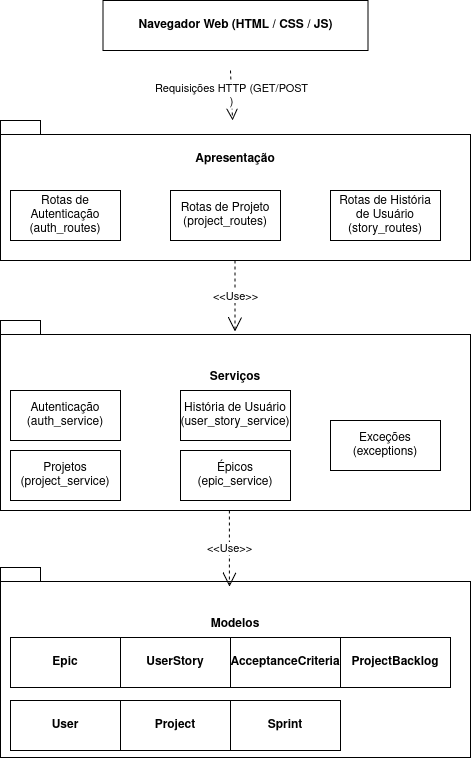

| Backlog Manager            |
| :------------------------- |
| **Caderno de Arquitetura** |

# BACKLOG MANAGER

# Caderno de Arquitetura

## 1. Propósito

Este documento descreve decisões, restrições, justificativas
elementos significativos e outros aspectos relevantes para o design e implementação
do sistema.

## 2. Objetivos e filosofia da arquitetura

A arquitetura deverá fornecer suporte ao desenvolvimento de um **sistema para gerenciamento de requisitos baseado em histórias de usuário**.
O sistema será desenvolvido como uma **aplicação web**, disponibilizando uma interface gráfica (site) para acesso às suas funcionalidades, será provido
por meio de um servidor onde a aplicação Python que implementa a lógica de negócios será executada.

A arquitetura deverá permitir o desenvolvimento das funcionalidades relacionadas ao gerenciamento de:

- Projetos;
- Product Backlogs;
- Sprint Backlogs;
- Histórias de usuário;
- Épicos;
- Critérios de aceitação;
- Story Points;
- MoSCoW;
- RICE score.

A divisão do trabalho considera responsabilidades específicas para frontend, backend e interface, mantendo a possibilidade de colaboração entre os integrantes.
Essa modularização é prática para garantir melhor manutenabilidade do software a ser desenvolvido, bem como permitir que mais de um desenvolvedor trabalhe no código
ao mesmo tempo, desde que em módulos com certo nível de independência.

## 3. Suposições e dependências

As seguintes definições foram estabelecidas inicialmente pelo grupo:

- O sistema será desenvolvido como um **site**.
- O sistema utilizará uma **interface gráfica**.
- O usuário deverá criar uma conta para acessar os serviços disponibilizados.
- O usuário deverá se autenticar para acessar os serviços.
- As funcionalidades do sistema serão organizadas a partir das histórias de usuário definidas pelo grupo.
- O sistema deverá trabalhar com projetos, Product Backlogs, Sprint Backlogs, histórias de usuário, épicos, critérios de aceitação, Story Points, MoSCoW e RICE.
- O projeto contará com integração entre a interface, o backend e o banco de dados.
- Usuários autenticados não serão separados por tipo, com todos tendo acesso igual as funcionalidades do sistema

Para cumprir os objetivos, será adotada a linguagem de programação Python 3, bem como frameworks para aplicação web
por ela suportados, nomeadamente o Flask para o desenvolvimento da aplicação (backend), por ser uma framework que se
destaca pela leveza, simplicidade e alto poder de customização. Além disso possui vasta documentação e é adotado por
grandes empresas. Junto ao Flask, serão utilizadas suas extensões como o motor de templates Jija2 para renderização
do lado do servidor, Flask-Login para gerenciamento de sessão e Flask-SQLAlchemy, para mapeamento objeto relacional e
banco de dados.

Este sistema não faz uso de APIs externas ou bancos de dados compartilhados com outros sistemas. É esperada a consistência
de dados através de um único banco de dados relacional (SQL), com as tabelas que se fizerem necessárias.

## 4. Requisitos significativos para arquitetura

Os principais requisitos funcionais que possuem impacto sobre a arquitetura são:

- Disponibilizar uma interface gráfica para utilização do sistema.
- Permitir criação de conta.
- Permitir autenticação do usuário.
- Permitir acesso aos serviços após autenticação.
- Permitir gerenciamento de projetos.
- Permitir gerenciamento de Product Backlogs.
- Restringir cada projeto a no máximo um Product Backlog.
- Permitir gerenciamento de vários Sprint Backlogs por projeto.
- Permitir movimentação de histórias entre backlogs.
- Permitir gerenciamento de histórias de usuário.
- Associar inicialmente uma história de usuário a um Product Backlog.
- Permitir gerenciamento e vínculo de épicos e histórias de usuário.
- Permitir gerenciamento de critérios de aceitação.
- Permitir atribuição de Story Points.
- Permitir classificação por MoSCoW.
- Permitir utilização e cálculo de RICE.

Esses requisitos deverão ser considerados na definição da estrutura do sistema, da persistência dos dados e da comunicação entre as partes da aplicação.

<!-- referencia ou lik para requisitos que devem ser implementados para
    realizar a arquitetura -->

## 5. Decisões, restrições e justificativas

### 5.1 Decisões

- O produto será desenvolvido como um **site**.
- Será utilizada uma **interface gráfica**.
- O sistema terá criação de conta e autenticação.
- As funcionalidades serão organizadas de acordo com as histórias de usuário definidas pelo grupo.
- O desenvolvimento terá divisão de responsabilidades entre arquitetura/backend, banco de dados e interface/frontend.
- A arquitetura de backend será dividida em três camadas: rotas, serviços e modelos, com cada camada podendo ter módulos (ex: autenticação, projetos, história de usuário, épicos)

### 5.2 Restrições

- Cada projeto poderá possuir no máximo um Product Backlog.
- Um projeto poderá possuir vários Sprint Backlogs.
- Uma história de usuário deverá ser inicialmente associada a um Product Backlog.
- Os Story Points deverão utilizar somente os valores definidos no projeto.
- Os critérios de MoSCoW deverão utilizar somente os valores definidos no projeto.
- Os critérios de RICE deverão seguir os valores definidos para Reach, Impact, Confidence e Effort.
- O cálculo do RICE deverá utilizar a fórmula definida no projeto.

### 5.3 Justificativas

- **Desenvolvimento de aplicação web (site)**: justificado pela facilidade
  de acesso dos usuários a um navegador, sem necessidade de instalação de
  software local, além de simplificar a implantação e manutenção do sistema por meio de um servidor centralizado.
- **Uso do Flask:** por ser leve, flexível e ter baixa curva de aprendizado, além de documentação extensa, é ideal para a equipe de desenvolvedores e permite estruturar a arquitetura de forma modular sem complexidade desnecessária de frameworks mais pesados.
- **Backend em camadas**: a modularização favorece a separação de responsabilidades e facilita a manutenção e teste do sistema. Também desacopla a lógica de acesso (interfaces HTML) da lógica de negócios e banco de dados.

<!-- decisoes a respeito de abordagens de arquiteutra e as restrições colocadas;
     decisao/constraint e justificativa em bullet points; pode ter lista de dos
     e donts-->

## 6. Mecanismos de arquitetura

Com base nas funcionalidades definidas, foram estabelecidos os seguintes mecanismos de arquitetura:

- **Autenticação do usuário e Gestão de Sessão**: senhas são armazenadas via hash criptográfico (`werkzeug.security`). O controle de sessão e estado do usuário autenticado é mantido pela extensão `Flask-Login`.

- **Persistência das informações**: utilização de Mapeamento Objeto-Relacional (ORM) com `Flask-SQLAlchemy`. Em desenvolvimento utiliza-se `SQLite`, com suporte a migração para SGBDs relacioanais em produção via alteração da URI de conexão.

- **Tratamento de erros e exceções**: camada centralizada de exceções personalizadas (`ServiceError` em `app/services/exceptions.py`) para captura global no servidor via `@app.errorhandler`, convertendo erros de negócio em mensagens de feedback (_flash messages_).

- **Comunicação entre a interface e o backend**: submissão de formulários HTML via métodos HTTP **POST** (criação/alteração/exclusão) e **GET** (navegação). Aplicação do padrão **Post-Redirect-Get (PRG)** com mensagens de contexto (_flash messages_) para evitar re-submissão de dados ao atualizar a página.

- **Gerenciamento dos dados dos projetos e backlogs**: encapsulamento das regras de associação (como limite de um Product Backlog por projeto e múltiplos Sprint Backlogs) diretamente na camada de serviços (`project_service.py`).

- **Gerenciamento e movimentação de histórias de usuário**: orquestração na camada de serviços (`user_story_service.py`) para vincular histórias a Product/Sprint Backlogs e associá-las a Épicos e Critérios de Aceitação.

- **Cálculo e validação da pontuação RICE e estimativas**: regras de validação para a sequência de Fibonacci (Story Points), classificações MoSCoW e o cálculo do RICE score ($\frac{R \times I \times C}{E}$) isolados na camada de serviços, espelhados via JavaScript no cliente (`projects.js`) apenas para pré-visualização instantânea na tela.

### 6.1 Ferramentas usadas no Backend

Para o desenvolvimento do backend do sistema, foram definidas inicialmente as seguintes dependências Python:

- **Flask 3.1.3:** microframework web utilizado para o desenvolvimento do backend da aplicação.
- **Flask-SQLAlchemy 3.1.1:** extensão que integra o Flask ao SQLAlchemy, facilitando a utilização do ORM e o gerenciamento da camada de persistência.
- **SQLAlchemy 2.0.54:** toolkit de banco de dados para Python, permitindo trabalhar com os dados por meio de consultas SQL ou utilizando orientação a objetos. A biblioteca também permite que a aplicação seja configurada para diferentes sistemas de banco de dados por meio da definição da URI de conexão.
- **Werkzeug 3.1.8:** biblioteca utilizada pelo Flask que fornece funcionalidades relacionadas à segurança, incluindo recursos para geração e verificação de hashes de senhas.
- **Pytest**: biblioteca para testes automatizados, para dar suporte a testes unitários e garantir a corretude do sistema ao longo dos incrementos

A configuração do banco de dados poderá ser definida posteriormente de acordo com a escolha do sistema de gerenciamento de banco de dados. Dessa forma, a aplicação poderá utilizar diferentes bancos de dados alterando sua configuração de conexão.

A configuração do ambiente de testes também poderá utilizar um banco de dados separado do banco principal, permitindo a realização dos testes sem interferir nos dados da aplicação.

### 6.2 Ferramentas usadas no Front-end

Para o desenvolvimento da interface do sistema, foram utilizadas
as seguintes tecnologias:

- **HTML5:** responsável pela estruturação semântica das páginas,
  formulários, componentes e elementos de interação.
- **CSS3:** utilizado na definição da identidade visual, organização
  dos componentes, estilização dos formulários e adaptação da interface
  para diferentes resoluções de tela.
- **JavaScript:** responsável pelas interações executadas no navegador,
  incluindo controle de diálogos, navegação entre abas, confirmações
  de operações e cálculo dinâmico da pontuação RICE.
- **Jinja2:** mecanismo de templates utilizado para renderizar páginas
  HTML dinamicamente e permitir o reaproveitamento de estruturas
  e componentes visuais.
- **Google Fonts (Inter):** utilizado para fornecer a tipografia
  da interface.

A utilização de templates permite reduzir a duplicação de código HTML
e manter uma estrutura visual consistente entre as páginas.
A separação dos estilos CSS por responsabilidade facilita a manutenção
e evolução da identidade visual.

O JavaScript complementa a renderização realizada pelo servidor,
permitindo interações locais sem a necessidade de transformar
a aplicação em uma SPA (Single Page Application).

## 7. Abstrações relativas à arquitetura

As principais abstrações identificadas representam as entidades e conceitos de domínio do sistema (mapeadas nas classes de modelo em `app/models/`), cujas regras e fluxos de negócio são manipulados e orquestrados pela camada de serviços (`app/services/`):

- **Usuário (`User`)**: entidade que representa os atores do sistema. Armazena as credenciais de acesso (`password_hash`), integra-se com a gestão de sessão via `UserMixin` (Flask-Login) e estabelece a relação de propriedade sobre os projetos criados.

- **Projeto (`Project`)**: entidade que delimita o escopo de um trabalho. Agrupa um único Product Backlog, múltiplos Sprint Backlogs e vincula-se ao seu usuário proprietário (`User`).

- **Product Backlog (`ProjectBacklog`)**: repositório principal de requisitos do projeto. Contém a lista global de histórias de usuário pendentes de alocação em sprints, mantendo relação 1:1 com o Projeto.

- **Sprint Backlog (`Sprint`)**: subconjunto iterativo e delimitado do backlog de um projeto. Agrupa histórias de usuário selecionadas para execução dentro de um ciclo específico.

- **História de Usuário (`UserStory`)**: unidade fundamental de requisito funcional do sistema, estruturada no formato padrão ("Como [papel] quero [ação] para [benefício]"). Armazena estimativas (Story Points), priorizações (MoSCoW, RICE) e relacionamentos com backlogs e épicos.

- **Épico (`Epic`)**: estrutura de alto nível que agrupa e categoriza histórias de usuário relacionadas por um objetivo funcional comum dentro do projeto.

- **Critério de Aceitação (`AcceptanceCriteria`)**: condições específicas que validam a conclusão de uma História de Usuário, estruturadas no formato ("Dado [contexto] quando [ação] então [resultado]").

- **Story Points**: conceito de estimativa de esforço atribuído às histórias de usuário, restrito aos valores discretos da sequência de Fibonacci (0, 1, 2, 3, 5, 8, 13, 21, 34, 55).

- **MoSCoW**: conceito de categorização de prioridade de requisitos em quatro níveis: Must have (M), Should have (S), Could have (C) e Won't have (W).

- **RICE Score**: pontuação de priorização quantitativa baseada nos parâmetros Reach (Alcance), Impact (Impacto), Confidence (Confiança) e Effort (Esforço), calculada pela fórmula (R x I x C) / E.

## 8. Arquitetura segundo perspectivas

### 8.1 Perspectiva funcional

O sistema será organizado em torno do gerenciamento de requisitos por meio de histórias de usuário, incluindo projetos, backlogs, histórias, épicos, critérios de aceitação e mecanismos de estimativa e priorização.

### 8.2 Perspectiva de interface

O sistema será disponibilizado como uma aplicação web, acessível por meio
de navegadores, utilizando uma interface gráfica construída com HTML5,
CSS3 e JavaScript.

A camada de apresentação utiliza templates Jinja2 para renderização
dinâmica das páginas HTML no servidor. Essa abordagem permite reutilizar
estruturas visuais e componentes, mantendo a organização das diferentes
telas do sistema.

A interface está organizada em páginas de autenticação, gerenciamento
de projetos e gerenciamento dos elementos de backlog. São utilizados
componentes visuais como cartões, formulários, diálogos modais, abas
de navegação e elementos de priorização.

A interação com o sistema ocorre principalmente por meio de formulários
HTML e requisições HTTP. O JavaScript complementa a experiência do
usuário com funcionalidades locais, como alternância de abas, abertura
e fechamento de diálogos, confirmações de operações e atualização
dinâmica da pontuação RICE.

Os estilos são organizados em arquivos CSS separados por responsabilidade,
permitindo a manutenção da identidade visual, dos componentes reutilizáveis
e das adaptações para diferentes tamanhos de tela.

Os detalhes da implementação, incluindo a estrutura dos templates,
organização dos arquivos CSS e JavaScript, descrição das telas e
comportamentos da interface, estão documentados em:

[Documentação da Implementação do Front-end](06-implementacao-frontend.md).

### 8.3 Perspectiva de dados

O sistema deverá armazenar as informações necessárias ao gerenciamento dos projetos e dos elementos relacionados às histórias de usuário.

A estrutura lógica e física dos dados é mapeada declarativamente via
classes Python (`models/`) gerenciadas pelo SQLAlchemy, utilizando o banco
SQLite em ambiente de desenvolvimento local com suporte a migração para
SGBD relacional (como MySQL/PostgreSQL) em produção.

### 8.4 Perspectiva de backend

O backend será responsável pela implementação das regras de negócio e dos serviços necessários para o funcionamento do sistema. Isso será feito por
meio de três camadas:

- **Camada de Apresentação (`routes/`):** responsável por lidar com requisições HTTP, extrair dados de requisição para chamar funções específicas da camada anterior, e fornecer dados ou recursos de resposta, como renderização de páginas HTML.
- **Camada de Lógica de Negócios (`services/`)**: responsável por concentrar e executar as regras de negócio da aplicação (como o cálculo do RICE score, validações de formato e tratamento de exceções de domínio). Recebe os dados já extraídos da camada de apresentação, processa as operações necessárias e orquestra a persistência de dados com a camada de modelos, garantindo o isolamento da regra de negócio independente da interface.
- **Camada de Acesso a Dados (`models/`)** responsável por fornecer classes equivalentes às entidades e domínios dos sistema, que persistem em banco de dados. Permite que a camada superior trabalhe com princípios de orientação a objetos, abstraídas as peculiaridades do banco de dados relacional configurado com o SQLAlchemy.

*Figura 1: Visão geral da arquitetura em camadas e dependências do sistema Backlog Manager.*

### 8.5 Perspectiva de integração

Deverá existir integração entre a interface, o backend e o banco de dados para permitir o funcionamento das funcionalidades do sistema. O SQLAlchemy permite trabalhar com tabelas e registros no banco de dados como se fossem objetos, segundo a abordagem de Mapeamento Objeto-Relacional (ORM). Como exposto na perspectiva de backend, este acesso é feito na camada de lógica de negócios usando as classes providas pela camada de acesso a dados.

## 9. Impacto de frameworks na arquitetura

### 9.1. Impacto do Framework Flask

Por ser um micro-framework não opinativo, o Flask não impõe arquitetura de pastas padrão. O impacto direto foi a necessidade de a equipe definir e disciplinar a separação em camadas (`routes`, `services`. `models`). Além disso, a camada de apresentação fica acoplada a estrutura do Flask por meio de objetos globais como `request`, `g`, e `session`.

### 9.2. Impacto da opção de Object-Relational Mapping com SQLAlchemy

Ao ultilizar SQLAlchemy, foi assumido o compromisso da inversão
no fluxo da criação de tabelas, que passam a ter sua estrutura
definida por meio de objetos Python. Para isso, é necessário escolher
os tipos de dados do SQLAlchemy correspondentes aos tipos de tabela no SQL.
Isso isola o backend de códigos SQL específicos, permitindo
portabilidade de independência de sistema de gerenciamento de banco de dados.

A utilização do ORM SQLAlchemy exige também atenção na estratégia de
carregamento das relações (eager vs. lazy loading). O impacto
arquitetural é a necessidade de otimizar consultas específicas na camada
de Services para evitar o problema de múltiplas consultas redundantes ao
banco na renderização de painéis complexos e listagens do backlog.
Dessa forma, não elimina a possibilidade de ser necessário escrever queries SQL personalizadas,
para atender a requisitos de performance.

Além disso, a possibilidade de utilizar uma configuração específica para testes permite que o sistema utilize
um banco de dados separado durante a execução dos testes.

### 9.3 Impacto geral na arquitetura

A utilização dessas ferramentas estabelece inicialmente uma arquitetura de backend baseada em **Flask**, com o gerenciamento da persistência realizado por meio de **Flask-SQLAlchemy e SQLAlchemy**. A escolha dessas tecnologias também permite manter a camada de acesso aos dados relativamente independente do sistema de banco de dados utilizado, enquanto o Werkzeug fornece recursos que podem ser utilizados nas funcionalidades relacionadas à autenticação e segurança.

As versões das dependências correspondem à definição inicial apresentada pelo grupo e poderão ser atualizadas durante o desenvolvimento caso seja necessário.
