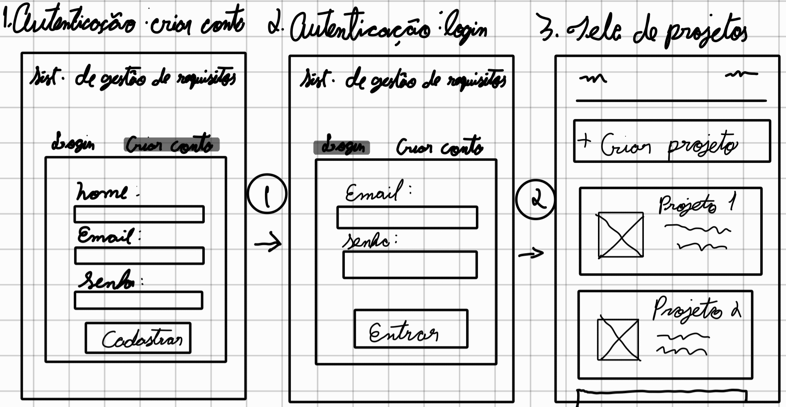
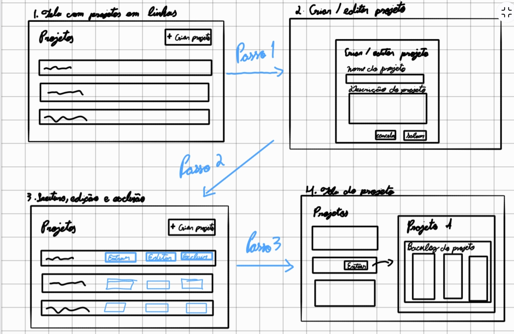
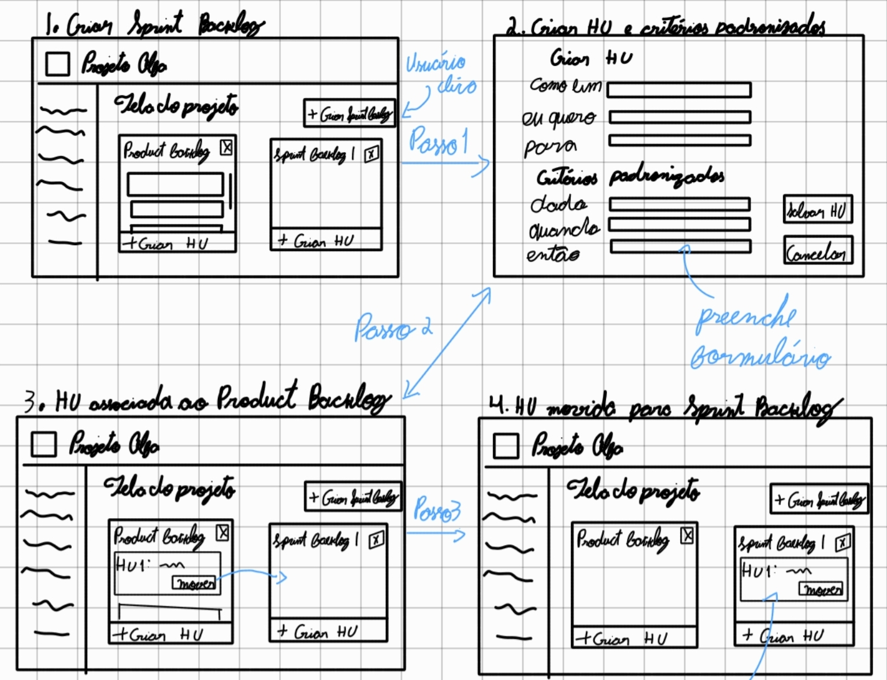
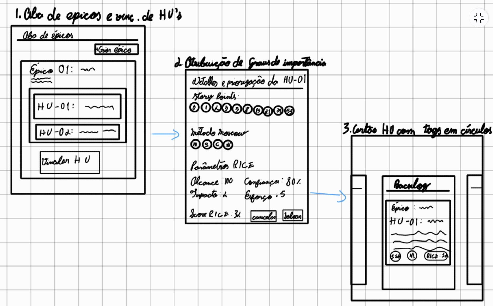
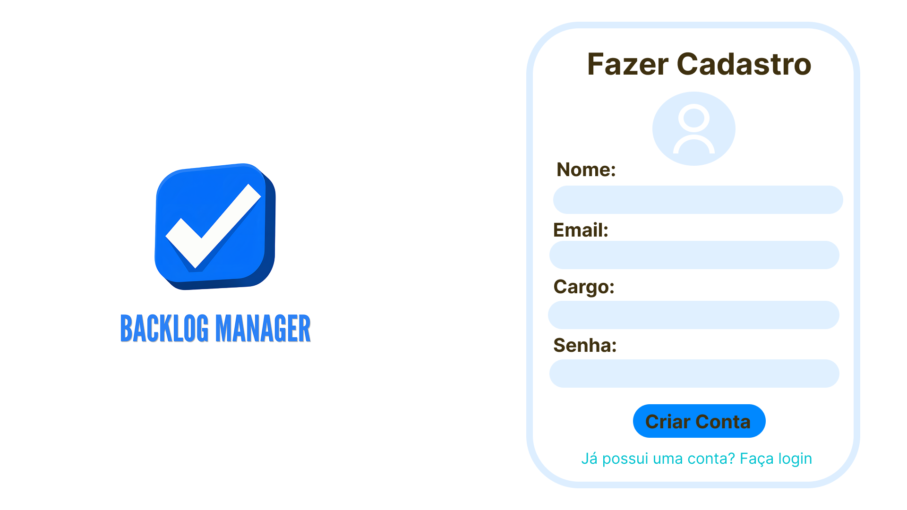
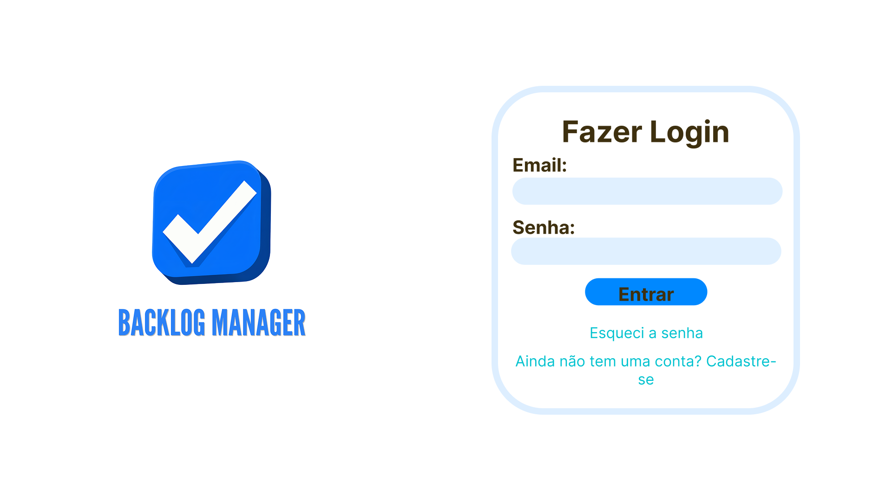
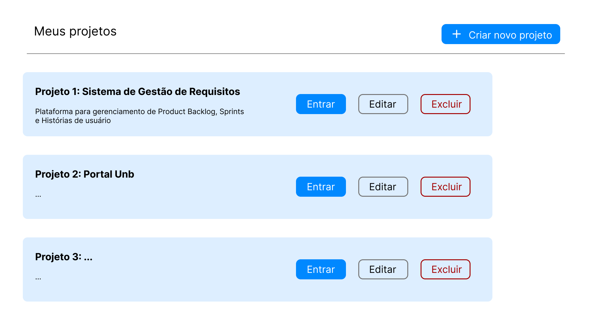
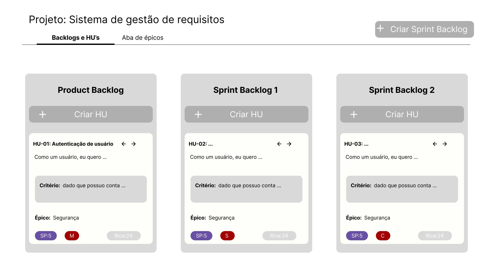
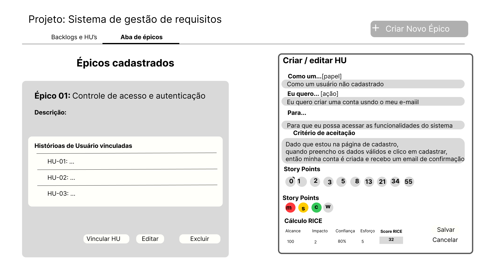

| **Backlog Manager** | **Responsável** |
| ---------------------------- | --- |
| **Projeto de interface** | Isaac Júnior Araújo Gomes - [231025270] |

# Projeto de Interface com o Usuário e Protótipo Inicial
## Artefatos 6 e 8 — Critérios 6 e 8

Este documento apresenta o projeto de interface com o usuário e o protótipo inicial do Backlog Manager, em conformidade com as Instruções 17, 18 e 22 e com os Critérios 6 e 8 da especificação do trabalho prático.

O projeto de interface é representado por **storyboards compostos por sequências de wireframes** (esboços simples de tela), estruturados a partir das três telas-base definidas pela equipe: **Tela de Autenticação**, **Tela de Projetos** e **Tela do Projeto**.

O protótipo inicial apresenta a representação visual dessas telas e de seus principais componentes, respeitando o layout e os requisitos definidos pela equipe.

---

# 1. Projeto de Interface com o Usuário

## 1.1. Storyboard 1: Criação de Conta, Autenticação e Acesso aos Serviços

- **Tela-base envolvida:** Tela de Autenticação → Tela de Projetos.
- **Requisitos cobertos:** (1), (2) e (3).
- **Cenário de uso:** Um novo usuário acessa a interface gráfica do sistema, cria uma conta com nome, e-mail e senha, autentica-se com suas credenciais e passa a ter acesso aos serviços de gestão de projetos.

| Quadro | Tela / Estado | Ação do Usuário | Resultado Esperado |
| :--- | :--- | :--- | :--- |
| **Quadro 1** | Tela de Autenticação (Aba *Criar Conta*) | Preenche *Nome*, *E-mail* e *Senha* e clica em `[Cadastrar Conta]`. | Conta criada no sistema (Requisito 2). |
| **Quadro 2** | Tela de Autenticação (Aba *Login*) | Insere e-mail e senha cadastrados e clica em `[Autenticar / Entrar]`. | Credenciais validadas via interface gráfica (Requisitos 1 e 2). |
| **Quadro 3** | Tela de Projetos | Sistema redireciona o usuário autenticado. | Acesso liberado aos serviços do sistema (Requisito 3). |

---

## 1.2. Storyboard 2: Gerenciamento Completo (CRUD) na Tela de Projetos

- **Tela-base envolvida:** Tela de Projetos → Tela do Projeto.
- **Requisitos cobertos:** (4).
- **Cenário de uso:** O usuário autenticado visualiza seus projetos em linhas horizontais sobre a tela branca, cria ou edita um projeto por meio do formulário modal, exclui registros indesejados e entra no espaço de trabalho de um projeto específico.

| Passo | Tela / Estado | Ação do Usuário | Resultado Esperado |
| :--- | :--- | :--- | :--- |
| **Passo 1** | Tela de Projetos (Listagem) | Clica no botão `[+ Criar Novo Projeto]` no canto superior direito. | Abre o modal de cadastro de projeto. |
| **Passo 2** | Modal Criar / Editar Projeto | Preenche *Nome do Projeto* e *Descrição do Projeto* e clica em `[Salvar]`. | Novo bloco horizontal cinza é adicionado à listagem. |
| **Passo 3** | Tela de Projetos (Ações) | Visualiza o bloco do projeto com descrição e botões `[Entrar]`, `[Editar]` e `[Excluir]`. | Permite ler, atualizar ou remover projetos (Requisito 4). |
| **Passo 4** | Transição para Tela do Projeto | Clica em `[Entrar]` no bloco do projeto desejado. | Abre o quadro de backlogs do projeto selecionado. |

---

## 1.3. Storyboard 3: Gestão de Backlogs, Histórias de Usuário e Movimentação

- **Tela-base envolvida:** Tela do Projeto (Aba *Backlogs e HUs*).
- **Requisitos cobertos:** (5), (6), (7), (8), (9), (12) e (13).
- **Cenário de uso:** Dentro de um projeto, o usuário visualiza o *Product Backlog* único à esquerda, cria um novo *Sprint Backlog*, cadastra uma História de Usuário com Critério de Aceitação nos formatos padronizados e a move do *Product Backlog* para o *Sprint Backlog*.

| Passo | Tela / Estado | Ação do Usuário | Resultado Esperado |
| :--- | :--- | :--- | :--- |
| **Passo 1** | Tela do Projeto (Colunas) | Clica em `[+ Criar Sprint Backlog]` no topo da tela. | Cria a coluna *Sprint Backlog 1* ao lado do *Product Backlog* (Requisitos 5 e 6). |
| **Passo 2** | Formulário de Nova HU | Clica em `[+ Criar HU]` e preenche os campos padronizados *"Como um [papel], eu quero [ação] para [benefício]"* e *"Dado [contexto], quando [ação], então [resultado]"*. | Valida e salva a História de Usuário com seus critérios de aceitação (Requisitos 9, 12 e 13). |
| **Passo 3** | Cartão no Product Backlog | Visualiza o cartão criado na coluna *Product Backlog* e clica em `[Mover ->]`. | Inicia a transferência da HU entre backlogs (Requisito 7). |
| **Passo 4** | Cartão no Sprint Backlog | Sistema atualiza a posição do cartão. | História de Usuário passa a integrar o *Sprint Backlog 1* (Requisito 8). |

---

## 1.4. Storyboard 4: Aba de Épicos e Priorização (Story Points, MoSCoW e RICE)

- **Tela-base envolvida:** Tela do Projeto (Aba *Épicos* e Modal de Priorização).
- **Requisitos cobertos:** (10), (11), (14), (15), (16), (17), (18) e (19).
- **Cenário de uso:** O usuário cria um Épico na aba dedicada, vincula Histórias de Usuário existentes a ele e atribui os graus de importância (Story Points de Fibonacci, etiqueta MoSCoW e parâmetros RICE), visualizando o resultado em tags circulares no cartão.

| Passo | Tela / Estado | Ação do Usuário | Resultado Esperado |
| :--- | :--- | :--- | :--- |
| **Passo 1** | Aba de Épicos | Clica em `[+ Criar Épico]`, define título/descrição e utiliza `[+ Vincular HU]` para associar histórias ao épico. | Épico criado e HUs vinculadas listadas em seu bloco (Requisitos 10 e 11). |
| **Passo 2** | Modal de Priorização da HU | Seleciona Story Points (`0, 1, 2, 3, 5, 8, 13, 21, 34, 55`), etiqueta MoSCoW (`M, S, C, W`) e preenche *Reach*, *Impact* (`3, 2, 1, 0.5, 0.25`), *Confidence* (`100%, 80%, 50%`) e *Effort* (Story Points). | Sistema calcula a pontuação RICE pela fórmula `(R × I × C) / E` (Requisitos 14 a 19). |
| **Passo 3** | Cartão Atualizado no Quadro | Salva a priorização e retorna à coluna do backlog. | Cartão exibe o vínculo com o épico e os círculos coloridos com `SP`, `MoSCoW` e `RICE`. |

---

## 1.5. Matriz de Rastreabilidade (Requisitos × Storyboards)

| Storyboard | Tela-Base | Cenário de Uso | Requisitos Cobertos |
| :--- | :--- | :--- | :--- |
| **Storyboard 1** | Tela de Autenticação | Cadastro de conta, login e liberação de acesso | (1), (2), (3) |
| **Storyboard 2** | Tela de Projetos | Criação, leitura, edição, exclusão e abertura de projeto | (4) |
| **Storyboard 3** | Tela do Projeto (Backlogs) | CRUD de backlogs, HU/critérios padronizados e movimentação | (5), (6), (7), (8), (9), (12), (13) |
| **Storyboard 4** | Tela do Projeto (Épicos e Priorização) | CRUD de épicos, vinculação de HUs, Story Points, MoSCoW e RICE | (10), (11), (14), (15), (16), (17), (18), (19) |

---

# 2. Protótipo Inicial: Prototipagem Visual das Telas

Em atendimento parcial ao **Critério 8** e à **Instrução 22**, foi produzido o protótipo inicial das três telas-base de operação do sistema (**Tela de Autenticação**, **Tela de Projetos** e **Tela do Projeto**), respeitando fielmente o layout e os requisitos definidos pela equipe.

## 2.1. Protótipo da Tela de Autenticação (Login e Cadastro)

- Interface gráfica com alternância entre as abas/modos de **Login** e **Criar Conta (Cadastro)** (Requisito 1).
- No fluxo de **Cadastro**, disponibiliza campos para preenchimento de **nome**, **e-mail** e **senha**, permitindo a criação de uma nova conta de usuário (Requisito 2).
- No fluxo de **Login**, realiza a autenticação clássica via **e-mail e senha** e, após validação, redireciona o usuário para a **Tela de Projetos**, liberando o acesso aos serviços do sistema (Requisitos 2 e 3).

## 2.2. Protótipo da Tela de Projetos

- Fundo em branco com blocos retangulares cinzas dispostos em linhas horizontais empilhadas.
- Exibição de título e descrição de cada projeto dentro do respectivo bloco, acompanhados dos botões **Entrar**, **Editar** e **Excluir** (Requisito 4).
- Botão **+ Criar Novo Projeto** posicionado no topo da tela branca.

## 2.3. Protótipo da Tela do Projeto (Quadro de Backlogs e HUs)

- Nome do projeto exibido no canto superior esquerdo e botão **+ Criar Sprint Backlog** no canto superior direito.
- Coluna única fixa do **Product Backlog** à esquerda e colunas de **Sprint Backlogs** lado a lado à direita, cada uma com botão de exclusão e botão **+ Criar HU**.
- Cartões de História de Usuário contendo título, descrição no padrão *"Como um... eu quero... para..."*, critério de aceitação no padrão *"Dado... quando... então..."*, setas de movimentação entre backlogs e **tags em círculos coloridos** (estilo Kanban) para **Story Points**, **MoSCoW** e **RICE**.

## 2.4. Protótipo da Tela do Projeto (Aba de Épicos e Formulário de Priorização)

- Aba dedicada para criação, edição, exclusão e listagem de **Épicos** em blocos cinzas, exibindo os títulos e descrições das HUs vinculadas.
- Formulário de edição da HU com campos guiados para os modelos textuais obrigatórios e cálculo automático da pontuação RICE pela fórmula `(Reach × Impact × Confidence) / Effort`.
