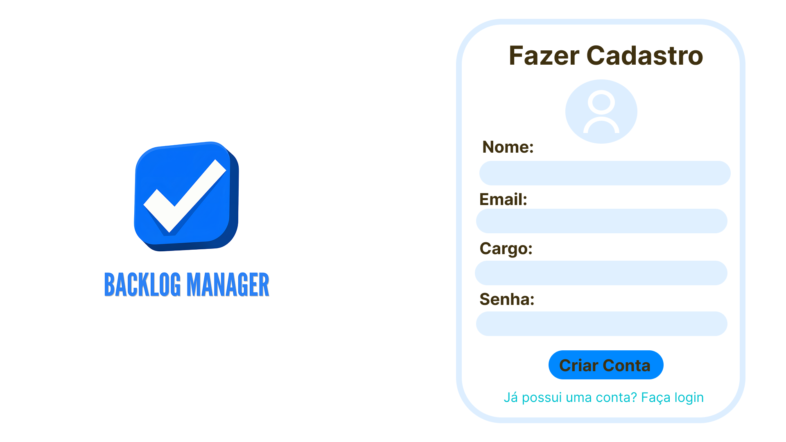
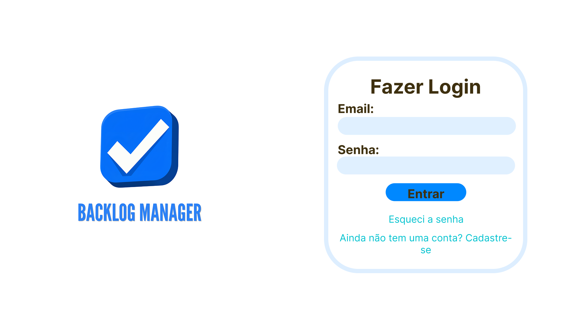
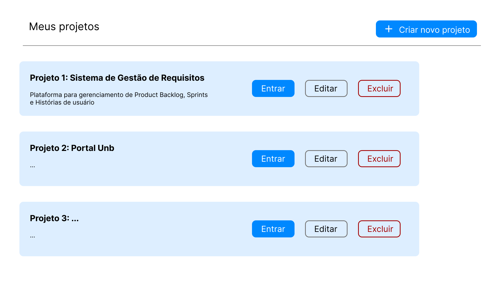
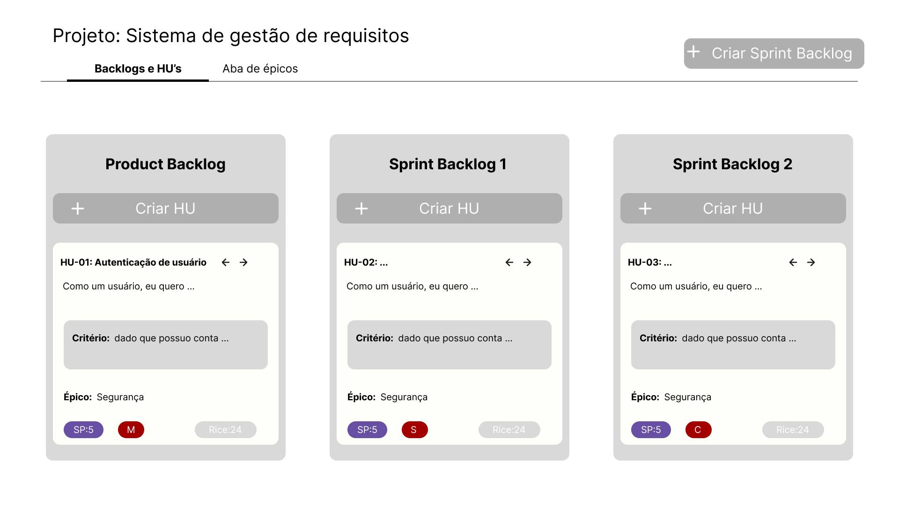
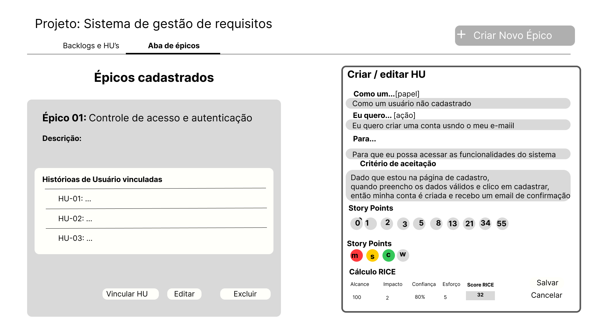

## Artefato 8 (Protótipo Inicial): Prototipagem Visual das Telas (Critério 8)

Em atendimento parcial ao **Critério 8** e à **Instrução 22**, foi produzido o protótipo inicial das três telas-base de operação do sistema (**Tela de Autenticação**, **Tela de Projetos** e **Tela do Projeto**), respeitando fielmente o layout e os requisitos definidos pela equipe:

1. **Protótipo da Tela de Autenticação (Login e Cadastro):**

   * Interface gráfica com alternância entre as abas/modos de **Login** e **Criar Conta (Cadastro)** (Requisito 1).

   * No fluxo de **Cadastro**, disponibiliza campos para preenchimento de **nome**, **e-mail** e **senha**, permitindo a criação de uma nova conta de usuário (Requisito 2).

   * No fluxo de **Login**, realiza a autenticação clássica via **e-mail e senha** e, após validação, redireciona o usuário para a **Tela de Projetos**, liberando o acesso aos serviços do sistema (Requisitos 2 e 3).

2. **Protótipo da Tela de Projetos:**

   * Fundo em branco com blocos retangulares cinzas dispostos em linhas horizontais empilhadas.

   * Exibição de título e descrição de cada projeto dentro do respectivo bloco, acompanhados dos botões **Entrar**, **Editar** e **Excluir** (Requisito 4).

   * Botão **+ Criar Novo Projeto** posicionado no topo da tela branca.

3. **Protótipo da Tela do Projeto (Quadro de Backlogs e HUs):**

   * Nome do projeto exibido no canto superior esquerdo e botão **+ Criar Sprint Backlog** no canto superior direito.

   * Coluna única fixa do **Product Backlog** à esquerda e colunas de **Sprint Backlogs** lado a lado à direita, cada uma com botão de exclusão e botão **+ Criar HU**.

   * Cartões de História de Usuário contendo título, descrição no padrão *"Como um... eu quero... para..."*, critério de aceitação no padrão *"Dado... quando... então..."*, setas de movimentação entre backlogs e **tags em círculos coloridos** (estilo Kanban) para **Story Points**, **MoSCoW** e **RICE**.

4. **Protótipo da Tela do Projeto (Aba de Épicos e Formulário de Priorização):**

   * Aba dedicada para criação, edição, exclusão e listagem de **Épicos** em blocos cinzas, exibindo os títulos e descrições das HUs vinculadas.

   * Formulário de edição da HU com campos guiados para os modelos textuais obrigatórios e cálculo automático da pontuação RICE pela fórmula `(Reach × Impact × Confidence) / Effort`.
