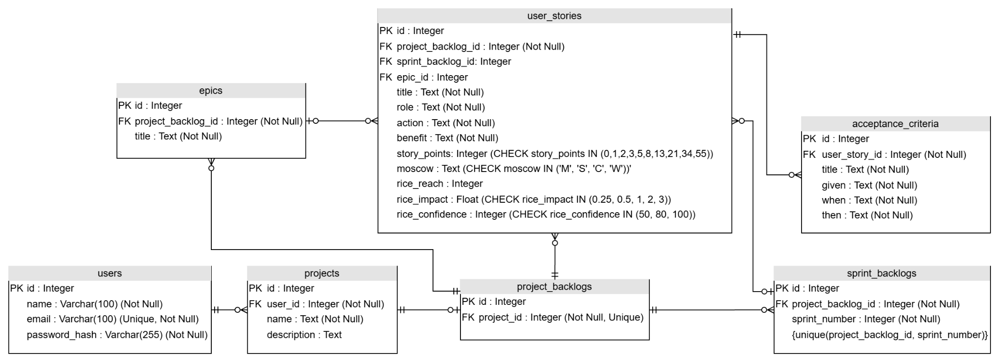

# Projeto Físico do Banco de Dados

| Sistema de Gestão de Backlog | |
| ---------------------------- | --- |
| **Projeto Físico do Banco de Dados** | **Versão de trabalho** |

## 1. Objetivo e escopo

Este documento apresenta o esboço do projeto físico do banco de dados do
Sistema de Gestão de Backlog. O modelo foi elaborado a partir dos modelos
SQLAlchemy da aplicação e do esquema SQLite criado por eles. O diagrama da
seção 2 foi atualizado com os nomes e tipos físicos correspondentes ao código.

O banco armazena usuários, projetos, seus backlogs, sprints, épicos, histórias
de usuário e critérios de aceitação. A implementação atual utiliza SQLite e
define sete tabelas.

## 2. Diagrama de tabelas e relacionamentos

**Leitura dos relacionamentos:** cada projeto pertence a um usuário e pode ter
zero ou um Product Backlog; um Product Backlog pode reunir várias histórias,
épicos e Sprint Backlogs. Uma história pode ainda não estar em uma sprint ou em
um épico. Uma história pode ter vários critérios de aceitação. As descrições
detalhadas das colunas e restrições estão nas seções a seguir.

## 3. Descrição das tabelas

### 3.1 `users` — usuários

**Propósito da tabela:** armazenar as contas dos usuários que acessam o sistema,
incluindo seus dados de identificação e autenticação. A senha é armazenada como
hash, nunca como texto puro.

| Coluna | Tipo | Nulo? | Chave/restrição | Descrição |
| --- | --- | --- | --- | --- |
| `id` | INTEGER | Não | PK | Identificador do usuário. |
| `name` | VARCHAR(100) | Não | — | Nome do usuário. |
| `email` | VARCHAR(100) | Não | UNIQUE | E-mail de acesso; não pode se repetir. |
| `password_hash` | VARCHAR(255) | Não | — | Hash da senha do usuário. |

**Relacionamentos:** um usuário pode possuir vários projetos. A chave
estrangeira correspondente está em `projects.user_id`.

### 3.2 `projects` — projetos

**Propósito da tabela:** registrar os projetos gerenciados no sistema e associar
cada projeto ao usuário responsável por ele.

| Coluna | Tipo | Nulo? | Chave/restrição | Descrição |
| --- | --- | --- | --- | --- |
| `id` | INTEGER | Não | PK | Identificador do projeto. |
| `name` | TEXT | Não | — | Nome do projeto. |
| `description` | TEXT | Sim | — | Descrição do projeto. |
| `user_id` | INTEGER | Não | FK → `users.id` | Usuário proprietário do projeto. |

**Relacionamentos:** cada projeto pertence a um usuário e pode possuir zero ou
um Product Backlog. A unicidade de `project_backlogs.project_id` garante o
limite de um backlog por projeto.

### 3.3 `project_backlogs` — Product Backlogs

**Propósito da tabela:** representar o Product Backlog de cada projeto e servir
como agrupador das histórias, épicos e sprints desse projeto.

| Coluna | Tipo | Nulo? | Chave/restrição | Descrição |
| --- | --- | --- | --- | --- |
| `id` | INTEGER | Não | PK | Identificador do Product Backlog. |
| `project_id` | INTEGER | Não | FK → `projects.id`; UNIQUE | Projeto ao qual o backlog pertence; a unicidade permite no máximo um por projeto. |

**Relacionamentos:** pertence a um projeto; pode possuir várias histórias,
épicos e Sprint Backlogs.

### 3.4 `sprint_backlogs` — Sprint Backlogs

**Propósito da tabela:** registrar cada Sprint Backlog associado a um Product
Backlog, identificando-o pelo número da sprint.

| Coluna | Tipo | Nulo? | Chave/restrição | Descrição |
| --- | --- | --- | --- | --- |
| `id` | INTEGER | Não | PK | Identificador do Sprint Backlog. |
| `project_backlog_id` | INTEGER | Não | FK → `project_backlogs.id` | Product Backlog ao qual a sprint pertence. |
| `sprint_number` | INTEGER | Não | UNIQUE composto com `project_backlog_id` | Número da sprint dentro do Product Backlog. |

**Relacionamentos:** cada Sprint Backlog pertence a um Product Backlog e pode
conter várias histórias. O par
(`project_backlog_id`, `sprint_number`) é único, impedindo números de sprint
repetidos no mesmo Product Backlog.

### 3.5 `epics` — épicos

**Propósito da tabela:** armazenar os épicos que organizam histórias
relacionadas dentro de um Product Backlog.

| Coluna | Tipo | Nulo? | Chave/restrição | Descrição |
| --- | --- | --- | --- | --- |
| `id` | INTEGER | Não | PK | Identificador do épico. |
| `project_backlog_id` | INTEGER | Não | FK → `project_backlogs.id` | Product Backlog ao qual o épico pertence. |
| `title` | TEXT | Não | — | Título do épico. |

**Relacionamentos:** cada épico pertence a um Product Backlog e pode agrupar
várias histórias. A referência ao épico em uma história é opcional.

### 3.6 `user_stories` — histórias de usuário

**Propósito da tabela:** armazenar as histórias de usuário e seus dados de
descrição, planejamento, estimativa e priorização.

| Coluna | Tipo | Nulo? | Chave/restrição | Descrição |
| --- | --- | --- | --- | --- |
| `id` | INTEGER | Não | PK | Identificador da história. |
| `project_backlog_id` | INTEGER | Não | FK → `project_backlogs.id` | Product Backlog da história. |
| `sprint_backlog_id` | INTEGER | Sim | FK → `sprint_backlogs.id` | Sprint Backlog; nulo quando a história não está em uma sprint. |
| `epic_id` | INTEGER | Sim | FK → `epics.id` | Épico associado; nulo quando não há associação. |
| `title` | TEXT | Não | — | Título da história. |
| `role` | TEXT | Não | — | Papel de quem deseja a funcionalidade. |
| `action` | TEXT | Não | — | Ação desejada. |
| `benefit` | TEXT | Não | — | Benefício esperado. |
| `story_points` | INTEGER | Sim | CHECK: `0, 1, 2, 3, 5, 8, 13, 21, 34, 55` | Estimativa em Story Points. |
| `moscow` | TEXT | Sim | CHECK: `M`, `S`, `C`, `W` | Classificação MoSCoW. |
| `rice_reach` | INTEGER | Sim | — | Alcance estimado para o cálculo RICE. |
| `rice_impact` | FLOAT | Sim | CHECK: `0.25, 0.5, 1, 2, 3` | Impacto estimado para o cálculo RICE. |
| `rice_confidence` | INTEGER | Sim | CHECK: `50, 80, 100` | Confiança percentual do cálculo RICE. |

**Relacionamentos:** cada história pertence a um Product Backlog; pode estar
associada a zero ou um Sprint Backlog e a zero ou um épico; pode possuir vários
critérios de aceitação.

**Observação sobre RICE:** a pontuação não é armazenada em coluna. Ela é
calculada pela aplicação como
`(rice_reach × rice_impact × rice_confidence / 100) / story_points` quando
todos os fatores estão informados e `story_points` é diferente de zero. O valor
zero é permitido para Story Points, mas não permite calcular a pontuação RICE.

### 3.7 `acceptance_criteria` — critérios de aceitação

**Propósito da tabela:** registrar as condições verificáveis para aceitar uma
história de usuário, no formato Dado/Quando/Então.

| Coluna | Tipo | Nulo? | Chave/restrição | Descrição |
| --- | --- | --- | --- | --- |
| `id` | INTEGER | Não | PK | Identificador do critério. |
| `user_story_id` | INTEGER | Não | FK → `user_stories.id` | História à qual o critério pertence. |
| `title` | TEXT | Não | — | Título do critério. |
| `given` | TEXT | Não | — | Contexto ou condição inicial (Dado). |
| `when` | TEXT | Não | — | Ação ou evento (Quando). |
| `then` | TEXT | Não | — | Resultado esperado (Então). |

**Relacionamentos:** cada critério pertence a uma história; uma história pode
ter zero ou vários critérios de aceitação.

## 4. Restrições e observações do esquema

- As chaves primárias são identificadores inteiros (`INTEGER`); no SQLite,
  `INTEGER PRIMARY KEY` também é o identificador da linha.
- O DDL declara chaves estrangeiras com comportamento padrão `NO ACTION`. No
  SQLite, a validação dessas chaves depende de `PRAGMA foreign_keys = ON` na
  conexão; essa configuração deve ser verificada para garantir sua aplicação.
- O banco impõe unicidade para `users.email`, `project_backlogs.project_id` e
  para o par `sprint_backlogs.project_backlog_id` / `sprint_number`.
- Os valores aceitos para Story Points, MoSCoW, Impact e Confidence são
  restringidos por `CHECK`; Reach não possui restrição de domínio no esquema
  atual.
- O esquema não contém datas, estado de sprint, estado de história ou uma coluna
  de pontuação RICE calculada.
- As chaves estrangeiras de épico e sprint não garantem, por si sós, que esses
  registros pertençam ao mesmo Product Backlog da história. Essa consistência
  precisa ser verificada pela aplicação ou tratada em uma evolução do esquema.

## 5. Alinhamento com a implementação

O diagrama e as tabelas deste documento usam os nomes físicos implementados,
como `users`, `projects`, `project_backlogs`, `user_stories` e
`projects.user_id`. O banco SQLite atual define sete tabelas conforme descrito
neste artefato.
